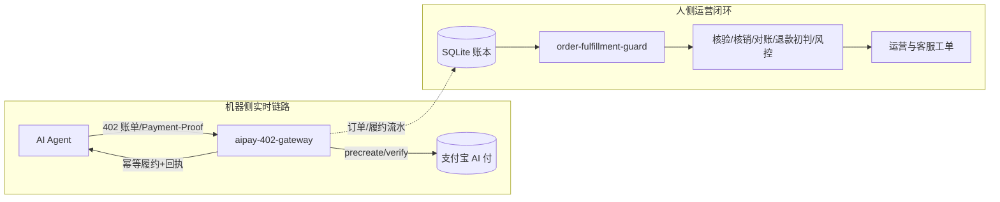

# PAYATHON 2026 · Build and Bill：AI 交易的可信履约双方案

> 支付宝 AI 付（AI Pay）年度黑客松参赛工程。主题不是"怎么收款"，而是回答一个更硬的问题：
> **机器替人付钱之后，谁来保证这笔钱对应的权益被准确、只此一次、可对账地交付？**

## 一句话真问题

AI 付解决了"Agent 能付款"，但社区 337 条问答里真正卡住开发者的是支付之后的事：
订单状态查不到、Agent 重试导致重复发货、金额被篡改、退款无据可依、平台账单对不平。
本仓库把 `verify` 之后的业务正确性沉淀成两套互补、可运行、可测试的工程，
覆盖 **Skill Pay（人侧）** 与 **Machine/Agent Pay（机器侧）** 两条赛道。

## 两个方案如何分工



| 维度 | `skills/order-fulfillment-guard` | `services/aipay-402-gateway` |
|---|---|---|
| 赛道 | Skill Pay | Machine Pay / Agent Pay |
| 形态 | 可安装技能 + CLI（零依赖标准库） | FastAPI 服务 + Docker + 客户端 SDK |
| 时机 | 事后核验、日结、退款初判、风控 | 实时 402 收款、在线核验、自动履约 |
| 使用者 | 卖家/运营/客服 | AI Agent / 机器调用方 |
| 测试 | 19 个 unittest | 11 个 unittest（含完整 HTTP 402 时序） |

两者共用同一套协议词汇（`out_trade_no / trade_no / resource_id / Payment-Proof`）
与同一套 **OFG 违规码**和五要素核验规则，保证机器侧的实时判定与人侧的事后审计口径一致。

## 仓库结构

```
payathon-2026-build-and-bill/
├── docs/
│   └── PROBLEM.md                  # 真问题定义、三方需求、方案边界
├── skills/
│   └── order-fulfillment-guard/    # Skill 层：交易履约核验官
└── services/
    └── aipay-402-gateway/          # Agent 层：402 自动履约网关
```

## 快速导航

- 真问题与需求论证：[`docs/PROBLEM.md`](docs/PROBLEM.md)
- Skill 方案说明：[`skills/order-fulfillment-guard/README.md`](skills/order-fulfillment-guard/README.md)
- Agent 网关说明：[`services/aipay-402-gateway/README.md`](services/aipay-402-gateway/README.md)

## 本地验证

```bash
# Skill 层（无需安装任何依赖）
cd skills/order-fulfillment-guard
python3 -m unittest discover -s tests -v          # 19 passed

# Agent 层
cd services/aipay-402-gateway
pip install -r requirements.txt
python3 -m unittest discover -s tests -v          # 11 passed
uvicorn app.main:app --port 8000                  # Mock 模式起服务
python examples/agent_client.py                  # 另开终端跑全链路
```

## 协议依据

实现对齐支付宝 AI 付 Machine Pay 公开协议：预下单
`alipay.aipay.agent.payment.precreate` 返回 `amt_pre_pay_id`，未支付返回
`HTTP 402` 与 `amtPaymentLink` 响应头，支付后携 Base64 `Payment-Proof` 重访，
经 `alipay.aipay.agent.payment.verify` 校验 `active / amount / out_trade_no /
resource_id / trade_no` 五要素后履约。设计同时参考了 x402 开放标准的
`402 → 支付 → verify → settle → receipt` 交互模型。

## 安全与合规说明

- 仓库不含任何真实商户密钥；真实 provider 的 RSA2 签名以 `TODO` 显式标注，密钥经环境变量注入。
- 所有金额使用字符串十进制（`Decimal`）处理，禁用浮点。
- Skill 层不发起网络请求、不直接打款，仅产出带证据链的判定建议。

## License

MIT，详见 [LICENSE](LICENSE)。
