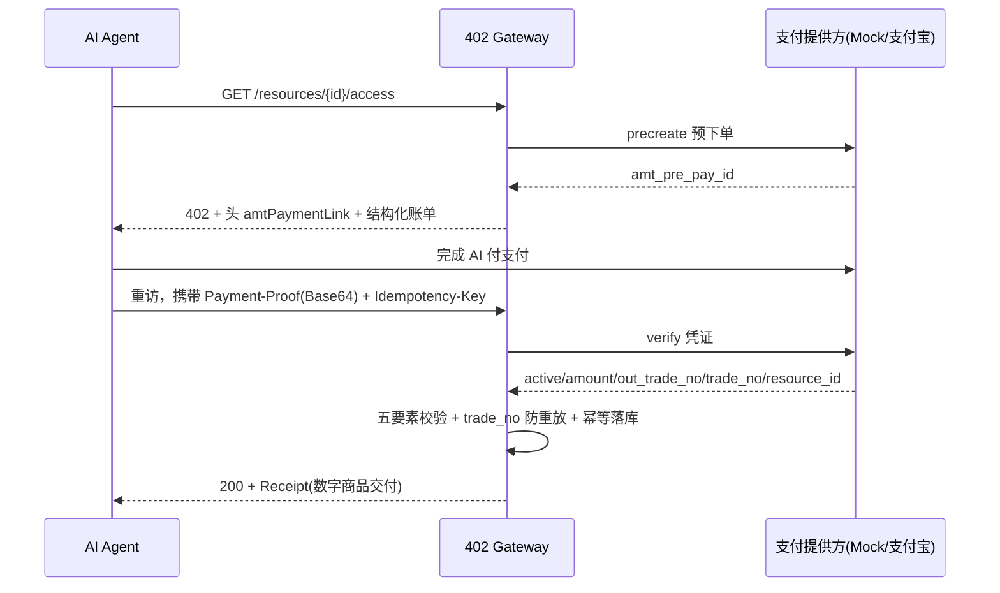

# aipay-402-gateway · AI 付自动履约网关（Machine/Agent Pay 方案）

PAYATHON 2026 参赛作品 · Machine Pay / Agent Pay 赛道。一个可直接部署的 FastAPI 服务，
把支付宝 AI 付的 **HTTP 402 支付交互**封装成标准 REST 接口：AI Agent 先读到机器可读目录，
访问资源时收到结构化账单与 `amtPaymentLink`，付款后携带 `Payment-Proof` 重试，
服务端完成平台核验、五要素校验、防重放与幂等履约，最终返回数字商品回执。

## 为什么不是"能收款就行"

`verify` 返回 `active=true` 只代表平台已收款。真实生产还必须回答：金额是否被篡改、
凭证是否对应本单本资源、同一 `trade_no` 是否被重试重复发货、客户端超时重试会不会重复交付。
本网关把这些规则固化在服务端，并提供对账与退款接口，构成闭环。

## 402 交互时序



## 目录结构

```
aipay-402-gateway/
├── app/
│   ├── main.py                 # FastAPI 装配与统一异常
│   ├── config.py               # env 配置，mock/alipay 切换
│   ├── models/schemas.py       # Pydantic 模型
│   ├── core/proof.py           # Payment-Proof 解码 + 五要素校验(OFG 码)
│   ├── providers/
│   │   ├── base.py             # PaymentProvider 抽象
│   │   ├── mock.py             # 无密钥全链路 Mock
│   │   └── alipay_aipay.py     # 真实 precreate/verify 适配骨架(RSA2 TODO)
│   ├── storage/repository.py   # SQLite 订单/预下单/履约/退款/幂等
│   ├── services/               # catalog / checkout / fulfillment 编排
│   └── api/                    # 目录、资源 402、订单对账路由
├── examples/agent_client.py    # 自动处理 402 的 Agent 客户端
├── tests/                      # 11 个 unittest（TestClient 全链路）
├── Dockerfile / docker-compose.yml
└── .env.example
```

## 快速开始（Mock 模式，无需密钥）

```bash
pip install -r requirements.txt
export AIPAY_PROVIDER=mock AIPAY_DB_PATH=./aipay_gateway.db
uvicorn app.main:app --reload --port 8000
# 另一终端
python examples/agent_client.py
```

或使用容器：`docker compose up --build`，随后访问 `http://localhost:8000/health`。

## 主要 API

| 方法 | 路径 | 说明 |
|---|---|---|
| GET | `/.well-known/aipay-catalog` | 机器可读资源目录 |
| GET | `/resources/{id}/access` | 无凭证返回 402；带 `Payment-Proof` 返回 200 回执 |
| POST | `/mock/pay/{pre_pay_id}` | 仅 Mock：模拟付款并产出 Payment-Proof |
| GET | `/orders/{out_trade_no}` | 订单与履约状态 |
| GET | `/admin/reconcile` | 收款/履约对账，标记 paid 未发货 |
| POST | `/orders/{out_trade_no}/refund` | 退款（Mock 全额，真实接退款接口） |

402 响应同时通过响应头 `amtPaymentLink: <amt_pre_pay_id>` 与 JSON 体下发支付标识，
对齐官方 Machine Pay 规范。

## 切换到真实支付宝 AI 付

1. 复制 `.env.example` 为 `.env`，设置 `AIPAY_PROVIDER=alipay` 并填入 `AIPAY_APP_ID`、密钥路径。
2. 在 `app/providers/alipay_aipay.py` 完成标注 `TODO` 的 RSA2 签名与网关 POST（业务编排无需改动）。
3. 沙箱联调通过后将 `AIPAY_USE_SANDBOX=false` 切到生产网关。

## 可靠性设计

- **金额**：全程字符串十进制比较，禁用 float，杜绝浮点误差。
- **幂等**：`Idempotency-Key` 命中回放首次回执；`trade_no` 建唯一约束，重放返回 OFG_1005。
- **可测**：`python -m unittest discover -s tests -v`，11 个用例覆盖正常流、篡改、重放、幂等、对账、退款。
- **可替换**：支付提供方依赖抽象接口，Mock 与真实实现无缝切换。

## 与 Skill 层方案的关系

`skills/order-fulfillment-guard` 面向人和运营侧做事后核验、对账与退款初判；
本网关面向机器侧做实时收款与自动履约。两者共用 OFG 违规码与同一套五要素核验口径。
